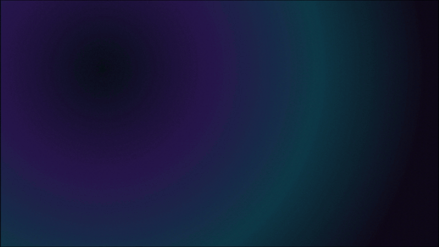
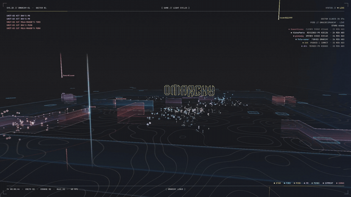
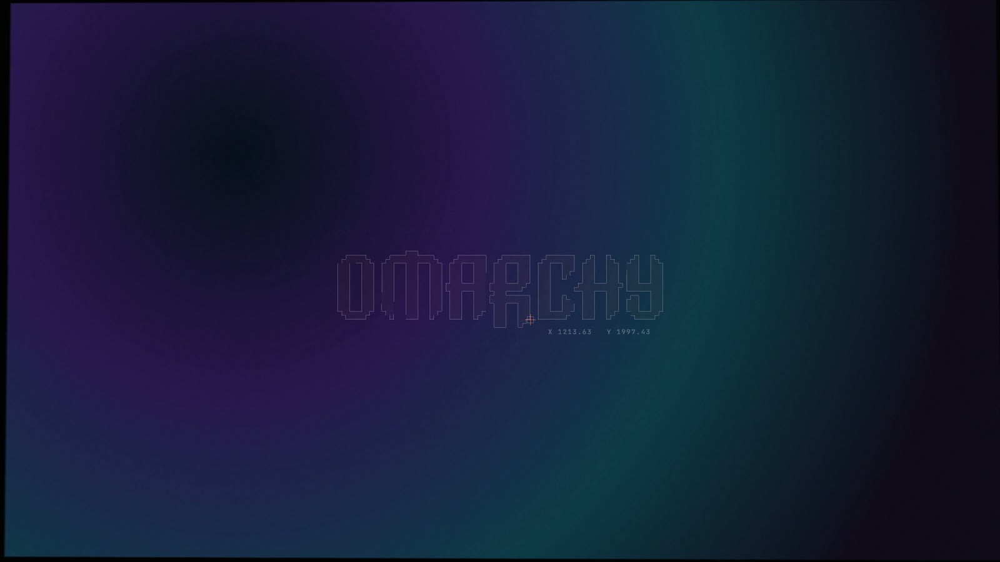
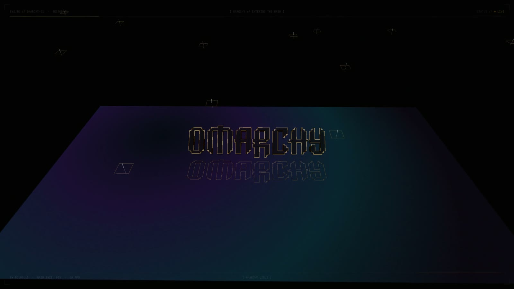
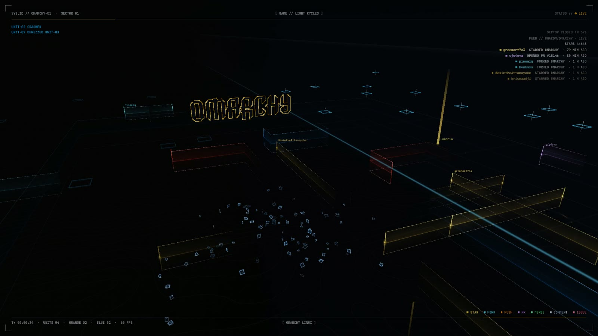
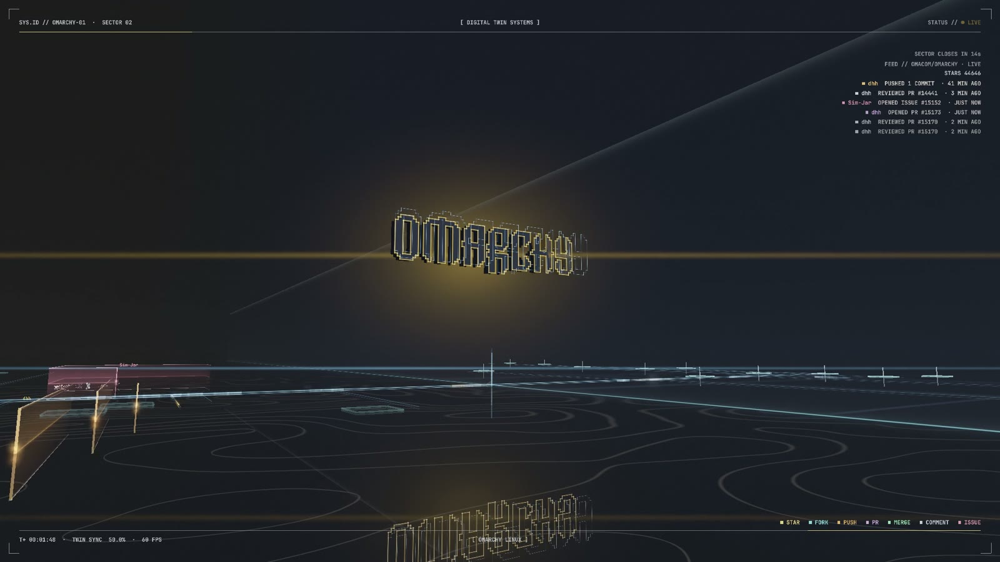
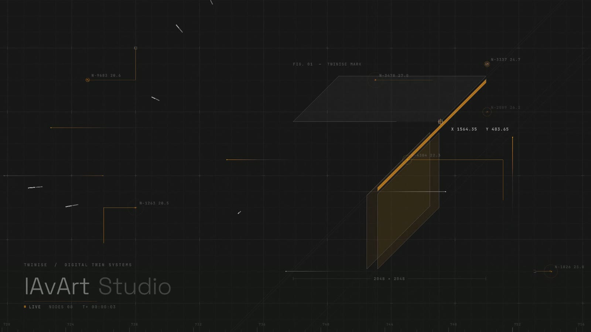

# Gridfall

A screensaver for [Omarchy](https://omarchy.org) that starts from your own desktop and falls into a light-cycle grid.



When your machine goes idle, nothing seems to happen at first. It's your wallpaper, exactly as you left it. Then a
logo sketches itself onto it, the camera starts to tilt, the wallpaper sinks into the floor and becomes a grid, and
the logo stands up out of it. A few of its edges peel off and turn into light cycles, and the battle starts.

The arena isn't just for show. Gridfall watches a GitHub repo (Omarchy itself, unless you point it somewhere else)
and every real event falls into the arena as a line of light with the person's name on it. Stars burst out four
ways and brake to a stop, forks split in two, pushes sprint off and keep accelerating, pull requests climb a
staircase, merges bring two lanes together into one, and issues spiral in on themselves. The panel on the right
keeps a running log of who did what.

Those trails aren't just decoration. They're walls like any other: a light cycle that rides into one is derezzed,
and a trail whose head runs into a cycle's light wall shatters, with the kill feed saying whose it was. And
everything breaks apart into its own kind of debris. Light cycles fall apart into cubes, stars and issues into
triangles, forks and pull requests into prisms, pushes into long slabs, and merges into green cubes.

Those trails aren't just decoration. They're walls like any other: a light cycle that rides into one is derezzed,
and a trail whose head runs into a cycle's light wall shatters, with the kill feed saying whose it was. And
everything breaks apart into its own kind of debris. Light cycles fall apart into cubes, stars and issues into
triangles, forks and pull requests into prisms, pushes into long slabs, and merges into green cubes.



After the battle the camera flies down a corridor of light toward the logo, which turns into a slowly turning
monolith with a cyan "digital twin" floating behind it, and then the whole thing loops back to the start.

It's written in Rust on top of wgpu, so it runs on the GPU at a steady 60 fps.

🎬 [Watch the full two-minute loop](docs/media/gridfall-demo.mp4)

| | |
|---|---|
|  |  |
|  |  |

## Installing

You'll need the Rust toolchain to build it once (`sudo pacman -S rust` if you don't have it).

```bash
omarchy plugin add https://github.com/lAvArt/gridfall
cargo install --locked --path ~/.config/omarchy/plugins/io.github.lavart.gridfall \
  --target-dir ~/.cache/gridfall/build
omarchy plugin enable io.github.lavart.gridfall
```

The `cargo install` step compiles Gridfall and puts it in `~/.cargo/bin`. The build happens in
`~/.cache/gridfall/build`, outside the plugin folder (Omarchy watches that folder, and a build inside it would make
the shell reload thousands of times).

That's it. Gridfall now runs after the same idle timeout as Omarchy's built-in screensaver (you can change it in
`~/.config/omarchy/shell.json` under `idle.screensaver`). Press any key or move the mouse and you're back. Omarchy's
lock screen still kicks in on schedule.

Want to see it straight away?

```bash
~/.config/omarchy/plugins/io.github.lavart.gridfall/bin/gridfall-launch
```

Or run it in a window you can close with Esc:

```bash
~/.cargo/bin/gridfall --windowed
```

One thing to know: while Gridfall is enabled it turns off Omarchy's stock terminal screensaver, otherwise you'd get
both at once. It turns it back on when you disable Gridfall.

## Making it yours

Out of the box Gridfall uses the Omarchy logo, your current wallpaper and your theme's accent colour, so it already
looks like your desktop. To bring your own logo, create `~/.config/gridfall/config.json`:

```json
{
  "logo": "~/Pictures/my-logo.svg",
  "name": "acme",
  "wordmark": ["Acme", "Labs"],
  "tagline": "BUILDING THINGS SINCE 2026",
  "footer": "ACME LABS",
  "repo": "acme/our-project"
}
```



Any SVG works: filled shapes, outlines, curves, holes, even text (it gets converted using your installed fonts).
The logo is scaled to fit and stands on its bottom edge. Every shape becomes a dark armour plate with glowing edges,
and you can change that per shape by giving it an `id` that starts with:

- `glow`, which makes it a white-hot light channel
- `echo`, a dimmer layer set back behind the rest, which separates from the logo as it rises
- `base`, a quiet base plate

There's an example in [`examples/roles-logo.svg`](examples/roles-logo.svg).

Here's everything you can set:

| Setting | What it does | Default |
|---|---|---|
| `logo` | Path to an SVG, or `"omarchy"` for the built-in one | `"omarchy"` |
| `wallpaper` | `"auto"` follows your Omarchy background. You can also give a path to an image, or `"none"` for plain graphite | `"auto"` |
| `name` | The name in the HUD | `"OMARCHY"` |
| `wordmark` | One or two words shown big at the start | none |
| `tagline` | A small line under the wordmark | none |
| `footer` | Text in the bottom-right corner | none |
| `repo` | The GitHub repo whose activity rains into the arena | `"omacom/omarchy"` |
| `accent` | The colour of the logo's edges, as `"#rrggbb"` | your theme's accent |
| `teams` | The two light-cycle colours | red and blue |
| `drafting` | Construction lines and measurements around the logo at the start | `true` |
| `logo_on_wallpaper` | Set to `true` if your wallpaper already has the logo on it, so it's there from the first frame | `false` |

## Recording a video

Gridfall can render straight to a video file, frame by frame at a fixed 60 fps, so you get a smooth result
however busy your machine is (needs `ffmpeg`):

```bash
gridfall --dump loop.mp4 --secs 121 --size 1920x1080
gridfall --record --dump arena.mp4 --secs 48     # just the arena, from every camera angle
```

## What it needs

- The Rust toolchain, to build it once
- A GPU with Vulkan drivers (anything Omarchy runs on)
- `curl` for the GitHub feed. It uses GitHub's public API without a token, checks every three minutes, and keeps a
  cached copy so it still has something to show offline
- `hyprctl`, `jq` and `notify-send`, which all ship with Omarchy
- `ffmpeg`, but only if you want to record videos

## Updating

```bash
omarchy plugin update io.github.lavart.gridfall
cargo install --locked --path ~/.config/omarchy/plugins/io.github.lavart.gridfall \
  --target-dir ~/.cache/gridfall/build
```

## Removing it

```bash
omarchy plugin remove io.github.lavart.gridfall
cargo uninstall gridfall
```

Removing or disabling Gridfall turns Omarchy's stock screensaver back on, if Gridfall was what turned it off. If you
ever need to do it by hand, run `omarchy-toggle screensaver-off off`. Afterwards you can delete
`~/.config/gridfall` and `~/.cache/gridfall` (which also holds the build files) too.

## Credits

Made by [lAvArt Studio](https://github.com/lAvArt). MIT licensed, see [LICENSE](LICENSE).
